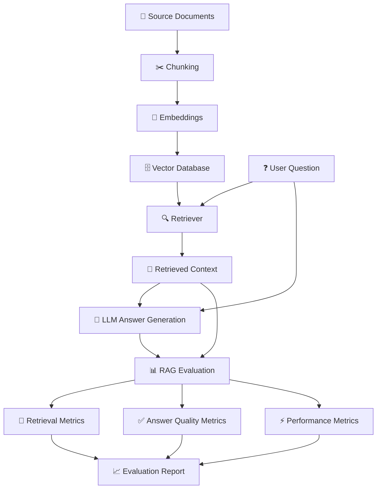

# 🧠 RAG Evaluation Framework

**🔍 Measure Retrieval. 🎯 Evaluate Answers. 🚀 Improve RAG.**

---

## 🌟 Overview

**RAG Evaluation Framework** focuses on measuring and improving the performance of Retrieval-Augmented Generation (RAG) systems.

RAG combines information retrieval with Large Language Models (LLMs) to generate answers grounded in external knowledge sources. However, a RAG system can produce incorrect answers when retrieval is poor, the context is incomplete, or the generated response is not supported by the retrieved information.

This project explores evaluation techniques that help measure retrieval quality, answer relevance, factual consistency, and overall system performance.

The framework is intended to support evaluation across different RAG architectures, including Basic RAG, Advanced RAG, and LangChain-based RAG pipelines.

## 🎯 Objectives

* 📚 Evaluate the relevance of retrieved document chunks.
* 🎯 Measure the quality of context retrieval.
* ✅ Check whether generated answers are supported by the retrieved context.
* 💬 Evaluate answer relevance to user questions.
* 📊 Measure retrieval and generation performance using quantitative metrics.
* 🔬 Compare different RAG configurations and retrieval strategies.
* 🛠️ Identify failure cases and improve the overall RAG pipeline.

## 🏗️ RAG Evaluation Workflow

## 🧪 Evaluation Techniques

### 1. 🔍 Retrieval Evaluation

Retrieval evaluation measures how effectively the system finds relevant information from the document collection.

| Metric                                             | Purpose                                                                                         |
| -------------------------------------------------- | ----------------------------------------------------------------------------------------------- |
| **Precision@K**                                    | Measures the proportion of the top K retrieved chunks that are relevant.                        |
| **Recall@K**                                       | Measures the proportion of all known relevant chunks retrieved within the top K results.        |
| **Hit Rate@K**                                     | Measures how often at least one relevant chunk appears in the top K results.                    |
| **Mean Reciprocal Rank (MRR)**                     | Rewards systems that rank the first relevant result higher.                                     |
| **Normalized Discounted Cumulative Gain (NDCG@K)** | Evaluates ranking quality while accounting for relevance and result position.                   |
| **Context Precision**                              | Evaluates whether relevant context is ranked above irrelevant context.                          |
| **Context Recall**                                 | Evaluates whether the retrieved context contains the information needed to answer the question. |

### 2. 💬 Answer Generation Evaluation

These metrics assess the quality of answers generated by the language model.

| Metric                  | Purpose                                                                                   |
| ----------------------- | ----------------------------------------------------------------------------------------- |
| **Faithfulness**        | Measures whether claims in the generated answer are supported by the retrieved context.   |
| **Answer Relevancy**    | Measures how well the generated answer addresses the user's question.                     |
| **Answer Correctness**  | Compares a generated answer against a trusted reference answer.                           |
| **Semantic Similarity** | Measures semantic similarity between a generated answer and a reference answer.           |
| **Exact Match**         | Checks whether the generated answer matches the expected answer exactly.                  |
| **F1 Score**            | Measures the balance between precision and recall when comparing answer tokens or labels. |

### 3. 🧩 Context Evaluation

Context evaluation helps identify problems in the information passed to the LLM.

* **Context Relevance:** Checks whether retrieved text is relevant to the question.
* **Context Coverage:** Checks whether the retrieved information covers the necessary facts.
* **Context Noise:** Identifies irrelevant or redundant information in retrieved chunks.
* **Context Utilization:** Checks whether the generated answer uses the available context appropriately.

### 4. ⚡ Performance Evaluation

RAG systems should also be evaluated for efficiency and operational reliability.

| Metric                 | Purpose                                                           |
| ---------------------- | ----------------------------------------------------------------- |
| **Retrieval Latency**  | Time taken to retrieve relevant context.                          |
| **Generation Latency** | Time taken by the LLM to generate an answer.                      |
| **End-to-End Latency** | Total time required to produce a response.                        |
| **Token Usage**        | Measures input and output tokens consumed.                        |
| **Cost per Query**     | Estimates the cost of processing each question.                   |
| **Failure Rate**       | Tracks failed requests, exceptions, and unsuccessful evaluations. |

## 🧰 Evaluation Across RAG Architectures

### 🟢 Basic RAG

* Document loading and text chunking.
* Embedding generation and vector storage.
* Similarity-based retrieval.
* Context-grounded answer generation.
* Retrieval relevance and answer faithfulness evaluation.

### 🔵 Advanced RAG

* Query rewriting and query expansion evaluation.
* Hybrid search evaluation, when implemented.
* Reranking effectiveness.
* Retrieval quality before and after reranking.
* Context compression and filtering evaluation.
* Comparison of different retrieval configurations.

### 🟣 LangChain RAG

* Evaluation of retriever outputs.
* Evaluation of chain-generated answers.
* Comparison of different retrievers and embedding models.
* Integration with reference question-answer datasets.
* Automated evaluation of faithfulness and answer relevance.

> **Note:** These are evaluation capabilities and suggested experiments. They should only be marked as implemented after the corresponding techniques have been added and tested in the codebase.

## 📊 Evaluation Dataset

A useful evaluation dataset can contain:

| Field                | Description                                                |
| -------------------- | ---------------------------------------------------------- |
| `question`           | The question asked by the user.                            |
| `ground_truth`       | A trusted reference answer.                                |
| `retrieved_contexts` | The document chunks retrieved by the RAG system.           |
| `generated_answer`   | The answer produced by the LLM.                            |
| `relevant_chunk_ids` | IDs of chunks known to be relevant, for retrieval metrics. |

A small dataset can be used for initial experiments, while a larger and carefully reviewed dataset can provide a more reliable assessment.

## 🛠️ Technology Stack

* 🐍 **Python** — evaluation logic and data processing.
* 🦜 **LangChain** — RAG pipeline integration, where applicable.
* 🧠 **Sentence Transformers** — semantic embeddings, where applicable.
* 🗄️ **FAISS or another vector database** — vector similarity search.
* 🤖 **LLM APIs** — answer generation and model-based evaluation.
* 📈 **RAGAS or custom evaluation code** — automated RAG quality metrics, depending on the implementation.
* 📊 **Pandas** — evaluation result analysis, if used.

The exact dependencies depend on the RAG pipeline being evaluated.

## 📈 Expected Evaluation Report

The framework can produce a report containing:

* Retrieval quality scores.
* Answer faithfulness and relevance scores.
* Comparison with trusted reference answers.
* Latency and token usage.
* Failed or low-quality examples.
* Recommendations for improving retrieval and generation.

## 🔬 Future Improvements

* Add automated regression tests for RAG pipelines.
* Compare embedding models and chunking strategies.
* Evaluate dense retrieval against hybrid retrieval.
* Compare retrieval results before and after reranking.
* Add human evaluation alongside automated metrics.
* Track performance across multiple datasets.
* Evaluate hallucination and out-of-document questions.
* Build visual dashboards for evaluation results.

## 👩‍💻 Author

**Sai Madhu Samyuktha**

Exploring Retrieval-Augmented Generation, Advanced RAG, LangChain, and LLM evaluation.

---

⭐ **Building more reliable and measurable RAG systems, one evaluation at a time.** ⭐

